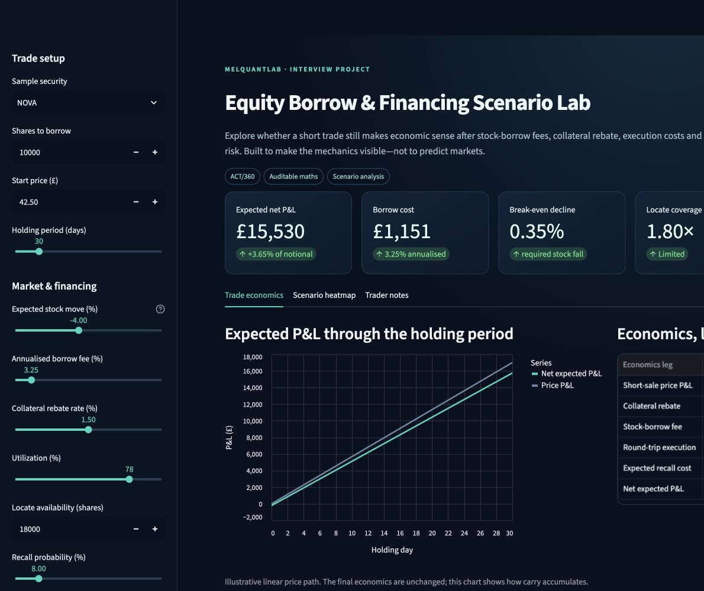
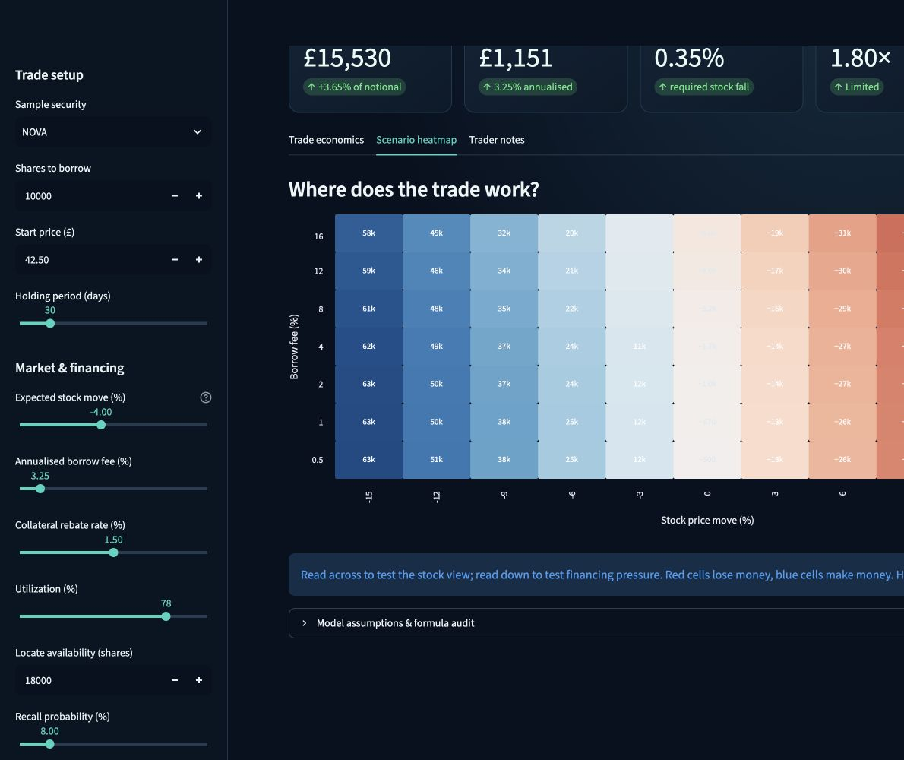

# Stock Borrow Analytics

An interactive Streamlit dashboard for exploring the economics of an equity short sale. Enter a proposed trade and financing assumptions to see how a stock-price move, borrow fee, collateral rebate, transaction costs, and possible recall affect the result.

This is a **scenario and learning tool**. It uses fictional securities and user-entered assumptions. It does not fetch live prices or borrow inventory, arrange a locate, or predict a stock's future return.



## What can you explore?

When an investor shorts a stock, a falling share price can produce a gain, but borrowing the shares has a cost. A trade can also incur execution costs, earn or pay a collateral rebate, and face the risk that the lender recalls the shares. This app puts those effects into one calculation so you can ask: **How far must the stock fall for this short trade to break even under my assumptions?**

The dashboard provides:

- **Trade inputs:** security, number of shares, starting price, expected price move, and holding period.
- **Financing inputs:** annual borrow fee, annual collateral rebate, and transaction cost per side.
- **Availability and recall inputs:** utilization, available shares for a locate, recall probability, and estimated cost if recalled.
- **Results:** expected net profit or loss (P&L), return on initial trade notional, borrow cost, break-even stock-price decline, locate coverage, and a simple crowding/recall risk label.
- **Visuals:** a line-by-line economics table, an illustrative P&L path, and a heatmap comparing stock-price moves with borrow fees.

The sidebar offers **NOVA, APEX, and ORBIT** as fictional starting presets, plus **Custom**. `data/sample_inventory.csv` contains five fictional example records, but the current dashboard does not load that CSV; its three presets are defined in `app.py`.

## Run it locally

You need Python and a terminal. Clone the repository, create a virtual environment, install the dependencies, and start Streamlit:

```bash
git clone https://github.com/awanishyadav967/stock-borrow-analytics.git
cd stock-borrow-analytics
python -m venv .venv
```

Activate the environment for your operating system:

```bash
# Windows PowerShell
.venv\Scripts\Activate.ps1

# macOS or Linux
source .venv/bin/activate
```

Then run:

```bash
python -m pip install -r requirements.txt
python -m streamlit run app.py
```

Streamlit prints the local address, normally `http://localhost:8501`. On macOS, you can also double-click `launch_dashboard.command`; it creates a local `.venv` on first use, installs the requirements, and opens the dashboard at `http://127.0.0.1:8501`.

## How to use the dashboard

1. Choose a sample security or **Custom**, then enter the number of shares and starting price.
2. Set the expected stock-price move and holding period. A **negative** price move benefits a short position.
3. Adjust the borrow fee, rebate, utilization, available locate shares, and recall probability. Open **Execution & recall assumptions** to change transaction and recall costs.
4. Read the headline metrics and **Trade economics** tab to see where the projected P&L comes from.
5. Use the **Scenario heatmap** tab to see how the result changes across stock moves from -15% to +15% and borrow fees from 0.5% to 16%. The **Trader notes** tab explains the main financing terms.



## How the calculation works

`analytics.py` performs the calculations separately from the Streamlit interface. Rates entered in the app are percentages. Borrow and rebate amounts use the **initial short-sale notional** and an **ACT/360** day-count convention:

```text
Initial notional       = shares x starting share price
Ending share price     = starting price x (1 + expected move / 100)
Price P&L              = shares x (starting price - ending price)
Borrow cost            = initial notional x (borrow fee / 100) x days / 360
Collateral rebate      = initial notional x (rebate rate / 100) x days / 360
Transaction cost       = initial notional x (cost per side in basis points / 10,000) x 2
Expected recall cost   = initial notional x (recall probability / 100) x (cover cost / 100)
Net expected P&L       = price P&L + rebate - borrow cost - transaction cost - expected recall cost
```

The displayed **break-even decline** is `(borrow cost + transaction cost + expected recall cost - rebate) / initial notional x 100`. For example, a displayed value of `1%` means the stock must fall about 1% over the chosen period for net P&L to reach zero, assuming the other inputs hold. **Locate coverage** is available locate shares divided by proposed shares; below `1` is flagged as insufficient. The availability and crowding/recall labels are simple rules based on coverage, utilization, and recall probability, not market forecasts.

The P&L path assumes a straight-line move from the starting price to the chosen ending price. It illustrates how financing accrues over time; it is not a simulated price path. The heatmap recalculates the same model for each price-move and borrow-fee combination while holding the other inputs fixed.

## Project files

| Path | Purpose |
| --- | --- |
| `app.py` | Streamlit controls, metrics, charts, and explanations |
| `analytics.py` | Trade inputs, P&L calculations, risk labels, and scenario grid |
| `data/sample_inventory.csv` | Fictional example inventory data; not currently loaded by the app |
| `tests/test_analytics.py` | Tests for the core calculations and locate flag |
| `.streamlit/config.toml` | Dashboard theme and server settings |
| `launch_dashboard.command` | macOS launcher |
| `requirements.txt` | Python dependencies |

Run the analytics tests after installing the dependencies:

```bash
python -m pytest -q
```

## Scope and attribution

The inputs and supplied inventory are fictional. The model does not include changing borrow fees, dividends or manufactured payments, margin funding, collateral haircuts, corporate actions, taxes, settlement failures, or portfolio effects. Its recall cost is a simplified expected value, so results depend heavily on the assumptions you choose. Do not treat the output as a live locate, financing quote, or investment recommendation.

The source project's existing documentation credits **Mel Nimota** for the Equity Borrow & Financing Scenario Lab and cites [DOI 10.5281/zenodo.21876200](https://doi.org/10.5281/zenodo.21876200). This README retains that attribution while describing the behavior of the code in this repository.
